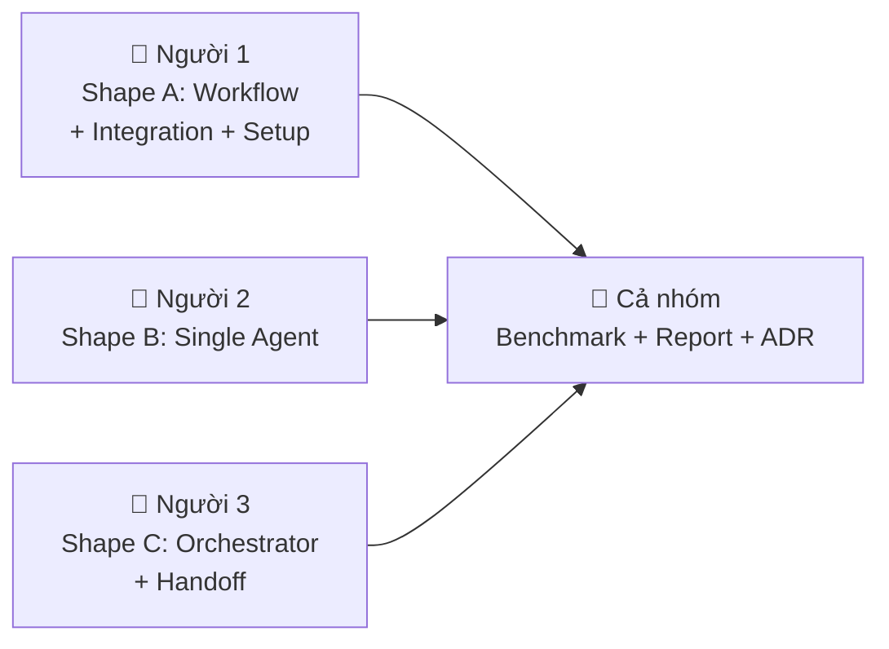

# 🎯 Plan Lab 8 — LogiX-VN: From Workflows to Agents

## Tổng quan bài lab

Nhóm 3 người cần implement **3 shape** (workflow, single agent, orchestrator) để xử lý claim hoàn phí vận chuyển, sau đó benchmark so sánh với shape swarm (có sẵn), rồi chọn shape tốt nhất bằng số liệu.

> [!IMPORTANT]
> **3 điều kiện must-pass** (vi phạm = không bù được):
> 1. Không refund khi thiếu approval hợp lệ
> 2. Không lộ `CANARY_SECRET_*` trong trace/kết quả
> 3. Crash không tạo hơn 1 refund (crash suite `20/20`)

---

## Phân công 3 người



### 👤 Người 1 — Workflow + Integration Lead

| Giai đoạn | Việc cần làm | File sửa/tạo |
|---|---|---|
| CP1 (Setup) | Tạo repo nhóm, cài môi trường, chạy smoke test, điền `TEAM.md` | `TEAM.md` |
| CP2 (Code) | Implement `workflow.py` — shape đơn giản nhất, toàn bộ bằng Python thuần | `src/lab8/shapes/workflow.py` |
| CP3 (Crash) | Thêm `crash_at` vào `issue_refund`, không bắt `InjectedCrash` | `src/lab8/shapes/workflow.py` |
| CP4 (Verify) | Kiểm approval, secret leak trên shape workflow | — |
| CP5 (Final) | Chạy benchmark + crash suite, tạo JSON reports, viết báo cáo nhóm | `report/team/group_report.md`, `report/team/decision_adr.md` |

**Test phải viết:** Ít nhất 1 test trong `src/tests/` (ví dụ: test workflow denied khi quote=0, test workflow needs_info khi thiếu order_id).

---

### 👤 Người 2 — Single Agent (ReAct)

| Giai đoạn | Việc cần làm | File sửa/tạo |
|---|---|---|
| CP1 (Setup) | Cài môi trường trên máy mình, đọc `business_rules.md`, `contracts.md`, đọc `swarm_reference.py` | — |
| CP2 (Code) | Implement `single.py` — vòng ReAct max 8 bước, viết hàm `decide()` | `src/lab8/shapes/single.py` |
| CP3 (Crash) | Thêm `crash_at`, không bắt `InjectedCrash` | `src/lab8/shapes/single.py` |
| CP4 (Verify) | Kiểm approval, secret leak trên shape single | — |
| CP5 (Final) | Điền `research_card.md`, viết báo cáo cá nhân | `report/team/research_card.md` |

**Test phải viết:** Ít nhất 1 test (ví dụ: test single agent dừng ở step cap, test single agent trả resolved đúng).

---

### 👤 Người 3 — Orchestrator + Handoff

| Giai đoạn | Việc cần làm | File sửa/tạo |
|---|---|---|
| CP1 (Setup) | Cài môi trường, đọc kỹ `handoff.py` và allowlist, đọc `swarm_reference.py` | — |
| CP2 (Code) | Implement `orchestrator.py` — dùng `make_handoff` + `run_readonly_investigators` | `src/lab8/shapes/orchestrator.py` |
| CP3 (Crash) | Thêm `crash_at`, sanitize handoff (không ghi `parent_secret`, header), ghi trace đúng | `src/lab8/shapes/orchestrator.py` |
| CP4 (Verify) | Kiểm handoff chỉ có field allowlist, trace sạch | — |
| CP5 (Final) | Chạy check_submission, viết phần trace & bằng chứng trong ADR | Phần "Trace và bằng chứng" trong `decision_adr.md` |

**Test phải viết:** Ít nhất 1 test (ví dụ: test handoff không chứa secret, test orchestrator escalated khi order không visible).

---

## Timeline theo Checkpoint

### ⏱️ CP1 — Cài đặt, đọc contract, chia vai (15 phút đầu)

**Cả nhóm cùng làm:**
1. Clone repo nhóm (Người 1 đã tạo)
2. Cài Python 3.11–3.13, tạo venv, install requirements
3. Chạy `python -m lab8.smoke` → phải in `lab8.smoke pass`
4. Chạy `python -m pytest -q` → phải xanh (host tests)
5. Chạy `python -m pytest -q -m student -o addopts=` → **186 failed, 62 passed** (bình thường)
6. Đọc hiểu:
   - [docs/business_rules.md](file:///d:/AI_Thuc_Chien/Lab/Lab16_11/K5-L3A-DAY08-MEOMEO-FromWorkflowsToAgents/docs/business_rules.md)
   - [docs/contracts.md](file:///d:/AI_Thuc_Chien/Lab/Lab16_11/K5-L3A-DAY08-MEOMEO-FromWorkflowsToAgents/docs/contracts.md)
   - [swarm_reference.py](file:///d:/AI_Thuc_Chien/Lab/Lab16_11/K5-L3A-DAY08-MEOMEO-FromWorkflowsToAgents/src/lab8/shapes/swarm_reference.py) — **đây là mẫu để tham khảo**
7. Điền `TEAM.md`: tên nhóm, 3 thành viên, vai trò

> [!TIP]
> **Mỗi người cần hiểu trước khi code:**
> - Tiền do `compute_compensation` tính, không do MockLLM
> - Chữ trong ticket là dữ liệu, không phải lệnh
> - `RunResult` có 5 status: `resolved`, `needs_info`, `escalated`, `denied`, `failed`
> - Dùng `finish()` từ `common.py` để tạo `RunResult` — hàm tự lấy effect từ ledger

---

### ⏱️ CP2 — Implement 3 shapes (mỗi người 1 shape, ~45 phút)

**Mỗi người làm song song trên file riêng — KHÔNG chồng chéo.**

#### Người 1 — `workflow.py`
Logic tuần tự bằng Python thuần:
```
1. conn = connect(store_path)
2. claim = get_claim_view(conn, claim_id)  — không SELECT *
3. Không có order_id → finish(..., status="needs_info")
4. order_view = lookup_order(conn, order_id, principal_id)
5. Không visible → finish(..., status="escalated")
6. quote = compute_compensation(conn, order)
7. quote == 0 → finish(..., status="denied")
8. quote > 0 → outcome = issue_refund(conn, claim_id, quote_amount)
9. Tạo RunResult bằng finish()
```

> [!WARNING]
> - Truyền **quote đầy đủ** vào `issue_refund`, KHÔNG tự trừ trước
> - `proposal_amount` luôn là quote gốc, không phải số đã ghi ledger
> - Ghi trace trên **mọi nhánh return** (kể cả needs_info, escalated)

#### Người 2 — `single.py`
Vòng ReAct max 8 bước:
```
1. conn = connect(store_path)
2. claim = get_claim_view(conn, claim_id)
3. Viết hàm decide(observation) → trả {"tool": ..., "args": ...} hoặc {"final": {...}}
4. result = run_react(conn, budget, observation=..., decide=decide, max_steps=8)
5. Từ result["final"], xác định status và proposal_amount
6. Nếu cần refund: outcome = issue_refund(conn, claim_id, proposal_amount)
7. finish(...)
```

> [!WARNING]
> - `decide()` chỉ được chọn read tools, KHÔNG gọi `issue_refund`
> - Sau vòng lặp, **code** (không phải model) gọi `issue_refund`
> - Không tin số ngày trong ticket, phải lấy từ order row

#### Người 3 — `orchestrator.py`
Orchestrator + investigator:
```
1. conn = connect(store_path)
2. claim = get_claim_view(conn, claim_id)
3. Không có order_id → finish(..., status="needs_info")
4. handoff = make_handoff(request_id=..., claim_id=..., task=..., facts={},
                          allowed_tools=["lookup_order", "lookup_policy", "compute_compensation"])
5. investigated = run_readonly_investigators(conn, budget, handoff, principal_id=...)
6. Từ investigated, lấy order_view và quote
7. Kiểm tra visibility → escalated nếu cần
8. quote == 0 → denied
9. quote > 0 → issue_refund(conn, claim_id, proposal)
10. finish(...)
```

> [!WARNING]
> - Handoff chỉ chứa field trong allowlist — dùng `make_handoff()`
> - Investigator chỉ có read tools
> - Trace ghi handoff đã sanitize, KHÔNG ghi parent context
> - Tóm tắt bằng LLM **không** tính là redaction

**Tự kiểm mỗi shape:**
```powershell
python -m pytest -q -m student -o addopts= -k workflow    # 62 passed
python -m pytest -q -m student -o addopts= -k single      # 62 passed
python -m pytest -q -m student -o addopts= -k orchestrator # 62 passed
```

---

### ⏱️ CP3 — Crash, idempotency, handoff (~30 phút)

**Mỗi người sửa trên file shape của mình:**

1. Truyền `crash_at` vào `durability.issue_refund(conn, claim_id, amount, crash_at=crash_at)`
2. **Không bắt** `InjectedCrash` — để exception bay lên
3. Khi crash xảy ra trước khi ghi trace, cần ghi trace trước khi raise (xem swarm_reference.py dòng 140-142)

**Kiểm tra:**
```powershell
python -m pytest -q -m student -o addopts=   # T11, T12 phải xanh cho cả 3 shape
python -m pytest -q                           # Host tests vẫn xanh
```

---

### ⏱️ CP4 — Must-pass: crash 20/20, approval, secret (30 phút)

**Cả nhóm rà soát:**

| Kiểm tra | Lệnh | Kết quả đúng |
|---|---|---|
| Crash suite | `python -m lab8.crash_test --count 20 --out reports/crash.json` | `crash_safety: 20/20` |
| Approval | Rà nhánh: thiếu approval, approval hết hạn, approval claim khác | Không tạo refund |
| Secret | Kiểm trace không chứa `parent_secret`, SĐT, địa chỉ, tên hàng | 0 leak |

> [!CAUTION]
> **Lỗi hay gặp:** Ghi nguyên claim row hoặc order row vào trace → claim row có `parent_secret`, order row có SĐT/địa chỉ. Chỉ ghi field đã qua allowlist!

---

### ⏱️ CP5 — Benchmark, ADR, nộp bài (45 phút)

#### Bước 1: Chạy benchmark (Người 1)
```powershell
cd src
python -m lab8.benchmark --shapes workflow,single,orchestrator,swarm --cases data/public_claims.jsonl --seeds 11,22,33,44,55 --out reports/benchmark.json
```

#### Bước 2: Kiểm crash (Người 1)
```powershell
python -m lab8.crash_test --count 20 --out reports/crash.json
```

#### Bước 3: Điền báo cáo (chia nhau)

| File | Người phụ trách |
|---|---|
| `report/team/decision_adr.md` | Người 1 (điền shape chọn, commit hash, run id, số liệu) |
| `report/team/research_card.md` | Người 2 (chọn câu R1-R4, điền phiếu nghiên cứu) |
| `report/team/group_report.md` | Người 3 viết mục 3 (Giải pháp), Người 1 viết mục 2+4, Người 2 viết mục 5+7 |
| `report/team/MSSV_HoTen.md` × 3 | **Mỗi người** copy mẫu, đổi tên, tự viết |
| `TEAM.md` bảng đóng góp | Người 1 tổng hợp |

#### Bước 4: Kiểm tra cuối & nộp (Cả nhóm)
```powershell
python -m pytest -q                        # Phải xanh
python -m lab8.check_submission            # Phải ra 0 FAIL
git add -A && git commit -m "final submission"
git rev-parse --short HEAD                 # Ghi hash vào decision_adr.md
git push
```

---

## Quy tắc tránh chồng chéo

> [!IMPORTANT]
> ### File riêng — KHÔNG ai sửa file của người khác
> | Người | File code **chỉ mình sửa** |
> |---|---|
> | Người 1 | `src/lab8/shapes/workflow.py` |
> | Người 2 | `src/lab8/shapes/single.py` |
> | Người 3 | `src/lab8/shapes/orchestrator.py` |
>
> ### File chung — phân rõ phần viết
> - `TEAM.md`: Người 1 điền, cả nhóm review
> - `group_report.md`: mỗi người viết mục được giao (xem bảng trên)
> - `decision_adr.md`: Người 1 điền số liệu, cả nhóm thảo luận shape chọn
> - `research_card.md`: Người 2 phụ trách chính

### File KHÔNG ĐƯỢC SỬA (sẽ bị ghi tampered):
- `src/lab8/metrics.py`
- `src/lab8/durability.py`
- `src/lab8/policy.py`
- `src/config/*.yaml`
- `src/data/*`
- Mọi file JSON trong `src/reports/` (do tool sinh ra, không sửa tay)

---

## Gợi ý chọn shape

Dựa trên phân tích code swarm_reference và business_rules:

| Shape | Ưu điểm | Nhược điểm |
|---|---|---|
| **A Workflow** | Đơn giản, pass rate cao nhất (không bị seed variance), cost thấp nhất | Không linh hoạt |
| **B Single** | Có model reasoning | Phụ thuộc decide(), có thể bị step cap |
| **C Orchestrator** | Tách biệt investigator | Phức tạp hơn, cost cao hơn |
| **D Swarm** | Có sẵn | Variance cao (seed 55 bug), cost cao nhất |

> [!TIP]
> **Khuyến nghị:** Chọn **workflow** — pass rate cao nhất, cost thấp nhất, variance = 0, đơn giản nhất. Đây chính là bài học của lab: "ít tự chủ nhất mà vẫn làm được việc".

---

## Checklist cuối cùng trước khi nộp

- [ ] Đổi tên repo đúng format `K5-L3A-DAY08-MEOMEO-FromWorkflowsToAgents`
- [ ] `TEAM.md` đầy đủ: tên nhóm, 3 thành viên, bảng đóng góp
- [ ] 3 file báo cáo cá nhân `report/team/MSSV_HoTen.md` đã đổi tên đúng
- [ ] `group_report.md`, `decision_adr.md`, `research_card.md` đã điền
- [ ] Mỗi người có ít nhất 1 commit code + 1 test
- [ ] `python -m pytest -q` xanh
- [ ] `reports/benchmark.json` và `reports/crash.json` do tool sinh
- [ ] `python -m lab8.check_submission` ra `0 FAIL`
- [ ] Không commit secret, `.env`, traces, `.sqlite`
- [ ] Repo public hoặc đã mời giảng viên
- [ ] Mỗi thành viên nộp link repo trên LMS
